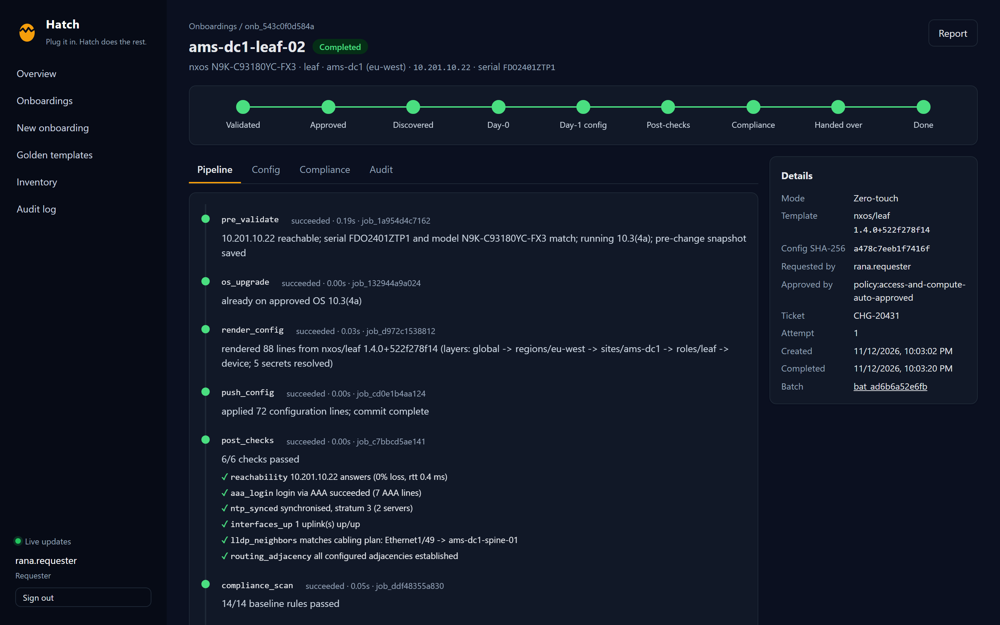
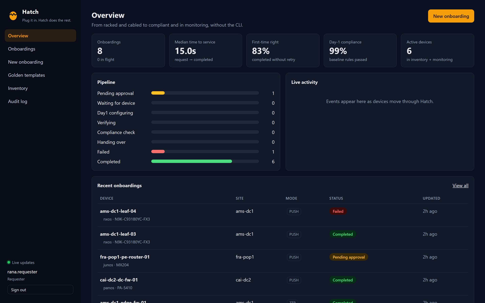
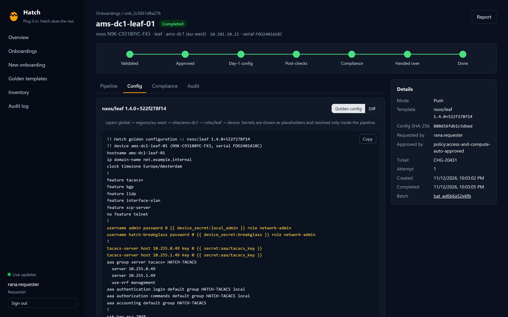
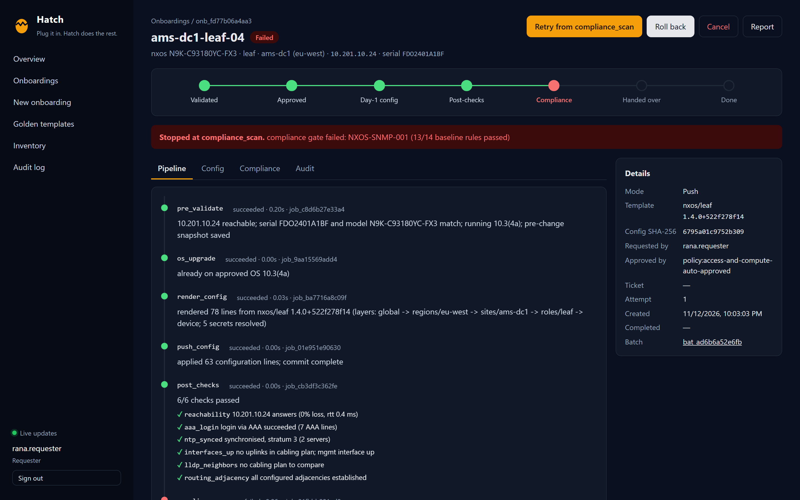
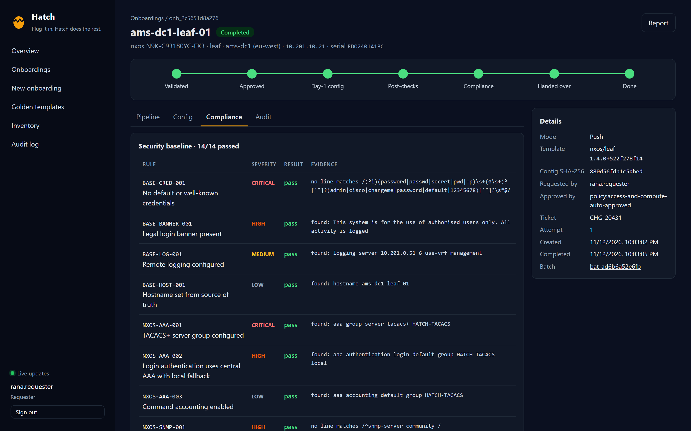
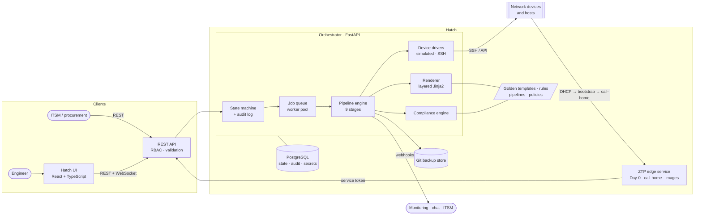
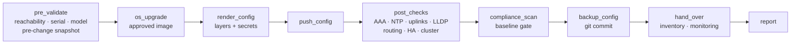

<div align="center">


# Hatch

**Plug it in. Hatch does the rest.**

Zero-touch onboarding for network devices and hypervisor hosts: from *racked and cabled*
to *configured, verified, compliant and in monitoring*, with no manual CLI work.

[](https://github.com/youhana-sobhy/Hatch/actions/workflows/ci.yml)


[Features](#features) · [Architecture](#architecture) · [Quickstart](#quickstart) · [API](#api-reference) · [Docs](docs/) · [Roadmap](#roadmap)



</div>

---

## Why Hatch

Bringing a new switch, firewall, router or hypervisor host into service usually means days of
tickets, configs copied from "a similar device", hand-typed credentials and hand-offs between
teams. Nobody can say where a device is in that process, and nobody can prove what was
configured or by whom.

Hatch replaces that with **one form (or zero, with ZTP)**:

1. The engineer registers the device. Hatch validates it against naming, IPAM, the device
   catalog and the template library before anything happens.
2. Hatch renders the full configuration from **layered golden templates** and shows a
   preview and a diff. Secrets never appear: they are resolved only inside the pipeline.
3. A policy decides whether a second engineer must approve.
4. The device powers on and **calls home** (ZTP), or Hatch pushes to it directly.
5. Hatch runs **post-checks**, a **security-baseline compliance scan**, takes the **first
   config backup**, registers the device in **inventory and monitoring**, and produces an
   **onboarding report** with a full **audit trail**.

If any step fails, Hatch stops, shows the exact stage and output, and offers **retry**
(resuming at the failed stage), **rollback** (restore the pre-change snapshot, or reset ZTP to
Day-0) or **cancel**.

## Features

| | |
|---|---|
| **Explicit state machine** | Every status change goes through one guarded `transition()` that enforces the allowed edges, writes the audit log and streams a live event. |
| **Pipeline engine** | Nine ordered stages, each in its own transaction with a `StageRun` record, structured details and redacted output. Per-vendor behaviour is configuration (`pipelines/<vendor>.yaml`), not code. |
| **Layered golden templates** | `global → region → site → role → device`, so every setting lives in exactly one place. Jinja2 with `StrictUndefined`: a missing variable is a hard error, never a silent blank line. Versions are content-addressed (`1.4.0+522f278f14`). |
| **Secrets that never leak** | Templates call `secret('aaa/tacacs_key')` and `device_secret('local_admin')`. Previews show placeholders; live renders register every value with a redactor that masks all stage output, evidence, backups, reports and diffs. Unique per-device passwords are generated and stored encrypted (Fernet) or in any KV v2 secret engine. A test asserts the real TACACS key appears on no API surface. |
| **Compliance as code** | YAML rules per vendor (`must_match`, `must_not_match`, `must_match_all`, `count_at_least`). Critical/high failures block the onboarding; medium/low are reported. 44 rules across 5 vendor families ship by default. |
| **Template governance in CI** | `hatchctl templates lint` test-renders every template with its fixture and runs the baseline against the result. A template that would produce a non-compliant device cannot merge. |
| **Zero-touch provisioning** | A stateless edge service serves vendor-native Day-0 (NX-OS POAP, Junos ZTP, FortiOS, PAN-OS bootstrap, ESXi kickstart) only to **pre-registered serials**, embeds a **one-time, expiring call-home token**, rate-limits per IP and never exposes the core API to devices. |
| **Approvals and RBAC** | Requester, approver, maintainer, admin and service roles, optionally scoped to sites. First-match approval policy per region/site/role/vendor/mode. Four-eyes rule: you cannot approve your own request. |
| **Bulk onboarding** | JSON batches or CSV import with per-row results. Leave hostname and IP blank and Hatch allocates them from the site naming pattern and IPAM. |
| **Live UI** | React + TypeScript: dashboard KPIs, a live journey track (*Discovered → Day-0 → Day-1 → Post-checks → Compliance → Handed over → Done*), config preview and diff, compliance evidence, audit trail, one-click report. Updates stream over a WebSocket. |
| **Runs anywhere** | A built-in **virtual device fleet** runs the entire flow on a laptop or in CI, with fault injection to demo failure, retry and rollback. An SSH driver talks to real devices. Docker Compose for local, Helm for Kubernetes, Prometheus `/metrics`. |

## Screenshots

| Overview | Validate and preview |
|---|---|
|  |  |
| **Failure with retry and rollback** | **Security-baseline evidence** |
|  |  |

## Architecture



**Orchestrator.** A FastAPI service that owns the API, the state machine, validation,
approval policy, the pipeline engine and every integration. Pipelines run on a bounded worker
pool, and a run is queued only after the transaction that requested it commits.

**ZTP edge service.** The only component that new devices talk to. It is stateless, can run as
a small pod next to each management network, and authenticates to the orchestrator with its
own service token.

**Content as code.** Templates, variable layers, compliance rules, pipelines and policies are
plain files in this repo, reviewed through pull requests and validated by CI.

More detail in [docs/architecture.md](docs/architecture.md).

### Onboarding state machine

```mermaid
stateDiagram-v2
    direction LR
    [*] --> REGISTERED
    REGISTERED --> VALIDATED: all checks pass
    VALIDATED --> PENDING_APPROVAL: policy requires approval
    VALIDATED --> APPROVED: auto-approved by policy
    PENDING_APPROVAL --> APPROVED: approver (not the requester)
    APPROVED --> WAITING_FOR_DEVICE: ZTP
    WAITING_FOR_DEVICE --> DAY0_APPLIED: call-home with one-time token
    APPROVED --> DAY1_CONFIGURING: push
    DAY0_APPLIED --> DAY1_CONFIGURING
    DAY1_CONFIGURING --> VERIFYING: config pushed
    VERIFYING --> COMPLIANCE_CHECK: post-checks pass
    COMPLIANCE_CHECK --> HANDING_OVER: baseline gate passes
    HANDING_OVER --> COMPLETED: backup, inventory, monitoring, report
    COMPLETED --> [*]

    DAY1_CONFIGURING --> FAILED
    VERIFYING --> FAILED
    COMPLIANCE_CHECK --> FAILED
    HANDING_OVER --> FAILED
    FAILED --> DAY1_CONFIGURING: retry
    FAILED --> VERIFYING: retry
    FAILED --> WAITING_FOR_DEVICE: ZTP reset to Day-0
    FAILED --> ROLLED_BACK: restore snapshot
    FAILED --> CANCELLED
    ROLLED_BACK --> [*]
    CANCELLED --> [*]
```



Any non-terminal state can move to `FAILED`; states before execution can be `CANCELLED`.
The table lives in [`state_machine.py`](backend/app/core/state_machine.py) and
`hatchctl state-diagram` prints the complete graph. See
[docs/state-machine.md](docs/state-machine.md).

### Pipeline



## Quickstart

### Option 1: Docker Compose (whole stack)

```bash
docker compose up --build
```

Open **http://localhost:8080**, pick a development persona, and seed a realistic mix of
onboardings (push, ZTP, approval, a transient failure, a compliance violation):

```bash
pip install httpx
python tools/hatch_demo.py seed
python tools/hatch_demo.py boot-all      # virtual devices power on and call home
```

API docs (OpenAPI) are at **http://localhost:8000/docs**.

### Option 2: Local development

```bash
python -m venv .venv && source .venv/bin/activate     # Windows: .venv\Scripts\activate
pip install -e "backend[dev]" -e "ztp-service[dev]"

# terminal 1: orchestrator (SQLite, simulated devices)
cd backend && uvicorn app.main:app --reload --port 8000
# terminal 2: ZTP edge service
cd ztp-service && uvicorn ztp.main:app --port 8081
# terminal 3: UI with hot reload
cd frontend && npm install && npm run dev                  # http://localhost:5173
```

Or use the `Makefile`: `make install`, `make dev-api`, `make dev-ztp`, `make dev-ui`,
`make test`, `make lint`.

### Try the flow from the command line

```bash
TOKEN="Authorization: Bearer dev-requester"

# validate and preview without creating anything
curl -s -H "$TOKEN" -H 'Content-Type: application/json' localhost:8000/api/v1/onboardings/dry-run -d '{
  "hostname": "ams-dc1-leaf-07", "serial": "FDO2401A1C7", "model": "N9K-C93180YC-FX3",
  "role": "leaf", "site": "ams-dc1", "mgmt_ip": "10.201.10.27",
  "vars": {"bgp_asn": 65107, "loopback0": "10.250.1.27"}}' | jq '.valid, .preview.diff' -r

# test-render every golden template and gate it on the security baseline
hatchctl templates lint
```

## API reference

All endpoints take `Authorization: Bearer <token>`. Full schema at `/docs`.

| Method | Path | Purpose |
|---|---|---|
| `POST` | `/api/v1/onboardings` | Create one onboarding, or a batch with `{"devices": [...]}` |
| `POST` | `/api/v1/onboardings/import` | Bulk import from CSV (auto-allocates blank hostnames and IPs) |
| `POST` | `/api/v1/onboardings/dry-run` | Validate and preview without creating |
| `GET` | `/api/v1/onboardings` | List and filter (`site`, `region`, `vendor`, `status`, `mode`, `batch_id`, `q`) |
| `GET` | `/api/v1/onboardings/{id}` | Detail with stage history, compliance and allowed actions |
| `GET` | `/api/v1/onboardings/{id}/preview` | Rendered golden config (secrets masked) and diff |
| `POST` | `/api/v1/onboardings/{id}/approve` | Approve (approver role, never your own request) |
| `POST` | `/api/v1/onboardings/{id}/retry` | Resume from the failed stage |
| `POST` | `/api/v1/onboardings/{id}/rollback` | Restore the pre-change snapshot (push) or reset to Day-0 (ZTP) |
| `POST` | `/api/v1/onboardings/{id}/cancel` | Cancel and release hostname, serial and IP |
| `GET` | `/api/v1/onboardings/{id}/report` | Onboarding report (`?format=html` or `json`) |
| `GET` | `/api/v1/ztp/bootstrap/{serial}` | Day-0 for a pre-registered serial (service role) |
| `POST` | `/api/v1/ztp/callhome` | Device call-home with its one-time token (service role) |
| `GET` | `/api/v1/templates` | Golden template library (`/templates/{vendor}/{role}` for source) |
| `POST` | `/api/v1/templates/{vendor}/{role}/render` | Test render with sample data, plus the baseline gate result |
| `GET` | `/api/v1/sites`, `/api/v1/ip-ranges` | Sites with region, and management IP ranges with utilisation |
| `GET` | `/api/v1/catalog` | Sites, models, roles and the state machine |
| `GET` | `/api/v1/catalog/suggest` | Next free hostnames and management IPs |
| `GET` | `/api/v1/compliance/rules` | Security baseline rules |
| `GET` | `/api/v1/devices` | Built-in inventory |
| `GET` | `/api/v1/audit` | Audit trail |
| `GET` | `/api/v1/stats` | Dashboard KPIs |
| `WS` | `/api/v1/events?token=` | Live status and stage events |
| `GET` | `/healthz`, `/readyz`, `/metrics` | Liveness, readiness, Prometheus metrics |

Examples for every endpoint: [docs/api.md](docs/api.md).

## Repository layout

```
hatch/
├── backend/                  FastAPI orchestrator
│   ├── app/api/              REST + WebSocket endpoints
│   ├── app/core/             state machine, pipeline, rendering, validation, policies,
│   │                         compliance, secrets, audit, events, worker
│   ├── app/drivers/          device drivers: simulated fleet, SSH
│   ├── app/integrations/     git backups, KV v2 secrets, webhooks
│   ├── app/reports/          onboarding report (HTML / JSON)
│   ├── app/cli.py            hatchctl: template lint/render, compliance check
│   └── tests/                58 tests, 90% coverage
├── ztp-service/              stateless ZTP edge service
├── frontend/                 React + TypeScript + Vite
├── golden-templates/         golden templates <vendor>/<role>/, layers, device catalog
├── compliance-rules/         security baseline per vendor (YAML)
├── pipelines/                pipeline definition per vendor (YAML)
├── policies/                 approval policy (YAML)
├── deploy/helm/hatch/        Helm chart
├── tools/                    demo seeder / virtual device boot, screenshots
├── docs/                     architecture, state machine, API, templates, ZTP, security…
└── docker-compose.yml
```

## Supported platforms

| Vendor family | Roles shipped | Day-0 mechanism | Post-checks |
|---|---|---|---|
| NX-OS | `leaf`, `border` | POAP script | reachability, AAA, NTP, uplinks, LLDP vs cabling plan, BGP |
| FortiOS | `edge-fw` | bootstrap config + call-home action | reachability, AAA, NTP, uplinks, HA sync |
| Junos | `pe-router` | ZTP config + op-script call-home | reachability, AAA, NTP, uplinks, LLDP, IS-IS/BGP |
| PAN-OS | `dc-fw` | `init-cfg.txt` bootstrap | reachability, AAA, NTP, uplinks, HA sync |
| ESXi | `compute-host` | PXE kickstart + `%firstboot` call-home | reachability, NTP, uplinks, cluster membership |

Adding a vendor means a template directory, a rules file, a pipeline file and (for real
hardware) a driver profile. See [docs/templates.md](docs/templates.md).

## Testing

```bash
make test         # orchestrator + ZTP service + UI
make lint         # ruff, ruff format, mypy, tsc
hatchctl templates lint
```

The orchestrator suite drives the real API end to end against the virtual fleet: push and ZTP
happy paths, approvals and four-eyes, validation, duplicates, batches and CSV import, injected
post-check and push failures with retry, rollback to snapshot, ZTP reset, the compliance gate
catching a bad override, site-scoped tokens, one-time tokens, and a **no-secret-leak** test
across every API surface. CI also boots the full Compose stack and onboards virtual devices.

## Roadmap

- [x] Push-mode onboarding with preview, approvals, post-checks, compliance, backup, report
- [x] Zero-touch provisioning with pre-registered serials and one-time tokens
- [x] Bulk CSV import with IPAM and naming allocation
- [x] Retry from the failed stage, rollback to snapshot, ZTP reset
- [x] Live UI, audit trail, Prometheus metrics, Helm chart
- [ ] NETCONF / RESTCONF and controller-API drivers alongside SSH
- [ ] OIDC single sign-on mapped onto the existing roles
- [ ] External job queue so orchestrator replicas can scale horizontally
- [ ] Alembic migrations for schema upgrades
- [ ] PDF export of the onboarding report
- [ ] Continuous drift detection: compare running config to golden daily, one-click remediation
- [ ] Safe template roll-outs to already-onboarded devices through the same pipeline
- [ ] Decommissioning flow (onboarding in reverse)
- [ ] Virtual-device labs in CI per template change (containerised network OS images)

## Documentation

| | |
|---|---|
| [Architecture](docs/architecture.md) | Components, data model, request and pipeline flows, design decisions |
| [State machine](docs/state-machine.md) | States, transitions, retry and rollback semantics |
| [API](docs/api.md) | Endpoint reference with examples |
| [Golden templates](docs/templates.md) | Layering, authoring, secrets, fixtures, governance |
| [Compliance](docs/compliance.md) | Rule format, severities, the pipeline gate |
| [Zero-touch provisioning](docs/ztp.md) | Day-0 per vendor, token lifecycle, DHCP setup |
| [Security](docs/security.md) | Threat model, secrets handling, RBAC, hardening |
| [Deployment](docs/deployment.md) | Docker Compose, Helm, configuration reference |
| [Development](docs/development.md) | Local setup, tests, adding a vendor or a stage |

## License

[MIT](LICENSE) © Youhana Sobhy
