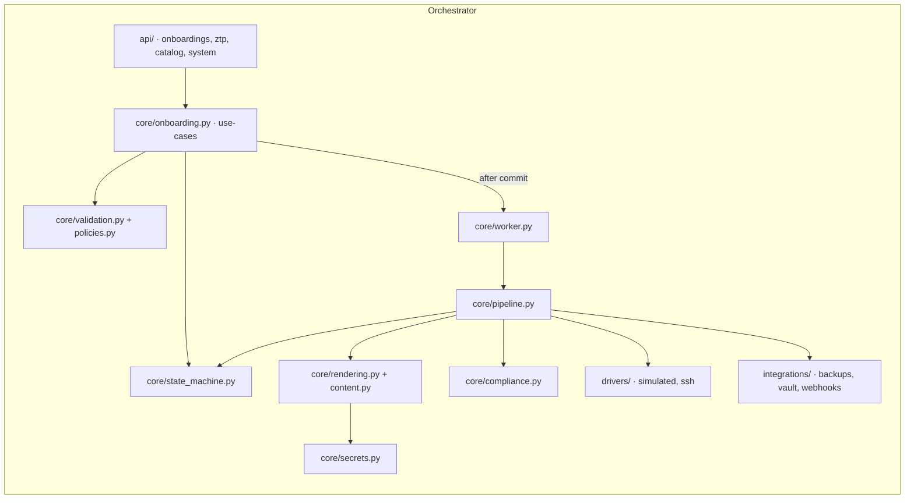
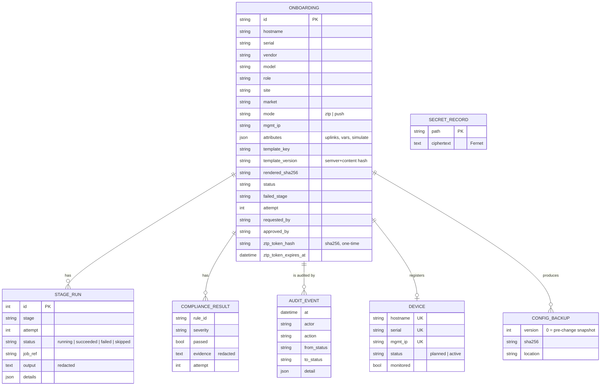
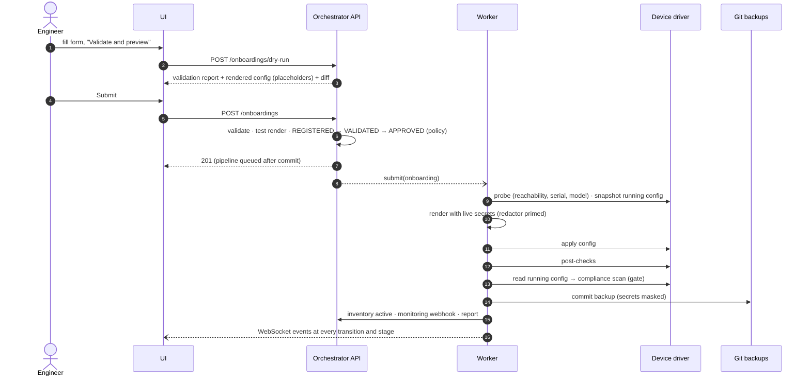
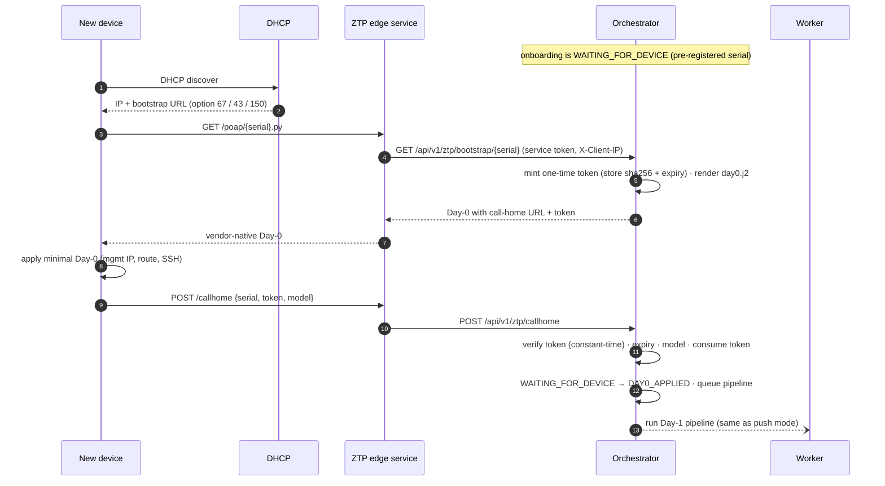

# Architecture

Hatch is three deployable components plus a body of governed content.

| Component | Tech | Responsibility | State |
|---|---|---|---|
| **Orchestrator** | Python 3.11+, FastAPI, SQLAlchemy 2, Jinja2 | REST + WebSocket API, RBAC, validation, approval policy, state machine, pipeline engine, rendering, compliance, secrets, integrations | PostgreSQL (SQLite for dev/tests), git backup store |
| **ZTP edge service** | Python, FastAPI, httpx | Vendor-native Day-0 bootstraps, call-home relay, image server, per-IP rate limiting | none |
| **UI** | React 18, TypeScript (strict), Vite, nginx | Forms, bulk import, preview/diff, approvals, live status, compliance evidence, reports, audit | none (token in local storage) |
| **Content** | YAML + Jinja2 in git | Golden templates, variable layers, device catalog, compliance rules, pipelines, approval policy | the repo |

## Layers

* **`api/`** is thin: parse, authenticate, call a use-case, commit, serialise. Errors from the
  core map to HTTP status codes (`ValidationFailed` → 422, `ActionRefused` → 403/409,
  `InvalidTransition` → 409).
* **`core/onboarding.py`** holds every use-case (`create`, `create_batch`, `dry_run`,
  `preview`, `approve`, `retry`, `rollback`, `cancel`, `bootstrap`, `callhome`). It is the only
  place that decides *what* should happen.
* **`core/state_machine.py`** is the only place that changes `Onboarding.status`.
  `transition()` checks the edge, records an `AuditEvent`, flushes and publishes an event.
* **`core/pipeline.py`** executes stages. It never talks to a device directly; it calls a
  `DeviceDriver`.
* **`drivers/`** are the only code that talks to devices. The simulated driver is a
  thread-safe in-memory fleet; the SSH driver uses per-vendor command profiles.

## Data model

`Device` doubles as the built-in source of truth and as the uniqueness guard: hostname, serial
and management IP each have a unique constraint, rows are created as `planned` at
registration and released on cancel or rollback.

## Request flow: push-mode onboarding

## Request flow: zero-touch

## Key design decisions

**One write path for status.** Bugs in workflow systems usually come from status being set
in many places. Here it is set in exactly one function, and the transition table is data that
tests and docs can read.

**Queue after commit.** `schedule()` stores pipeline requests in `session.info`; an
SQLAlchemy `after_commit` hook submits them. A worker therefore never races a row that is not
yet visible, and a rolled-back request never starts a pipeline.

**One transaction per stage.** Progress is visible live, a crash loses at most one stage,
and every stage leaves a `StageRun` row even when it fails.

**Prime the redactor before anything runs.** At the start of every run (including a resumed
one) Hatch renders the config once with live secrets purely to register their values with the
redactor. Even a retry that starts at `compliance_scan` therefore masks secrets in its output.

**Content-addressed template versions.** `1.4.0+522f278f14` combines the declared semantic
version with a hash of every file in the template directory, so "which config was applied" is
unambiguous even if someone forgets to bump the version.

**Pluggable at the edges, simple in the middle.** Drivers, secret backends and outbound
integrations are interfaces with small, swappable implementations. The core has no vendor
SDKs and no dependency on any external automation platform.

**A real simulator, not mocks.** The virtual fleet behaves like devices where it matters
(running config replaced on apply, checks derived from the config, faults injectable), which
lets the same end-to-end tests run on a laptop, in CI and in a demo.

## Scaling notes

The orchestrator runs pipelines in-process on a bounded thread pool, which comfortably handles
refresh projects of hundreds of devices on one replica (pipelines are I/O-bound). Running
several replicas requires moving the queue out of process (see the roadmap); everything else
(state in Postgres, stateless ZTP and UI) already scales horizontally.
