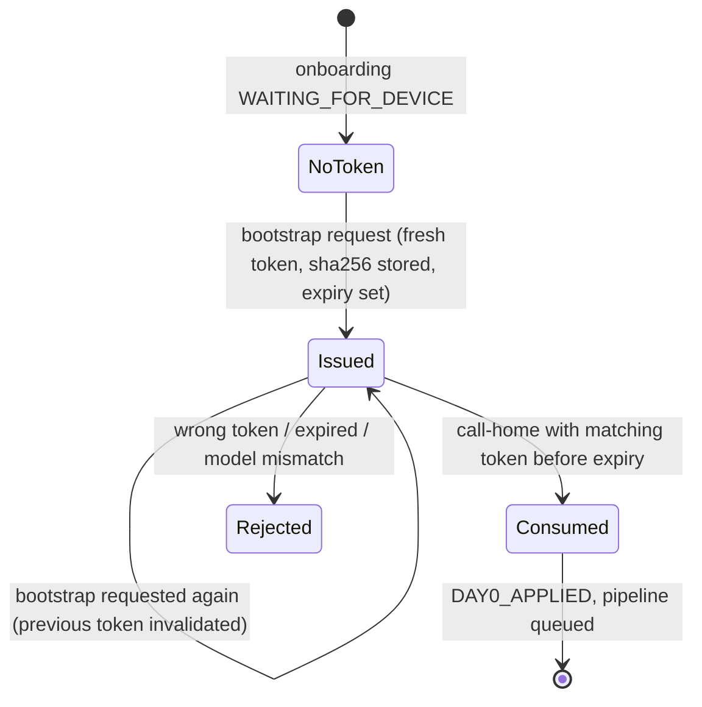

# Zero-touch provisioning

With ZTP the technician only racks, cables and powers on. The device finds Hatch over DHCP,
applies a minimal Day-0, calls home, and Hatch pushes the full Day-1 configuration.

## Components

* **ZTP edge service** ([`ztp-service/`](../ztp-service)): the only Hatch endpoint devices
  reach. Deploy it centrally, or as a small pod per site when management networks cannot reach
  the core. Stateless; its only secret is its service token.
* **Orchestrator** renders Day-0 from `templates/<vendor>/<role>/day0.j2` and owns the token
  lifecycle.

## Vendor endpoints

| Platform | Mechanism | Point DHCP at |
|---|---|---|
| NX-OS | POAP (option 67 bootfile) | `http://<ztp>/poap/<serial>.py` (or a POAP script that appends the serial) |
| Junos | ZTP (option 43 sub-options) | `http://<ztp>/junos/<serial>.conf` |
| FortiOS | DHCP + bootstrap config | `http://<ztp>/fortios/<serial>.conf` |
| PAN-OS | bootstrap package `init-cfg.txt` | `http://<ztp>/panos/<serial>/init-cfg.txt` |
| ESXi | PXE + kickstart | `http://<ztp>/esxi/<serial>.ks` |
| any | generic | `http://<ztp>/bootstrap/<serial>` |

Call-home: `POST http://<ztp>/callhome` with `{"serial", "token", "model", "ip"}`, or
`GET /callhome?serial=&token=&model=` for platforms whose Day-0 can only issue a GET. OS images
are served from `HATCH_ZTP_IMAGE_DIR` at `/images/<name>`.

## Token lifecycle



* Bootstraps are served only for serials whose onboarding is `WAITING_FOR_DEVICE`, which
  means it was registered, validated and approved. Anything else gets an opaque `404`.
* The raw token exists only in the Day-0 payload; Hatch stores its SHA-256 and compares in
  constant time.
* Tokens expire after `HATCH_ZTP_TOKEN_TTL_MINUTES` (default 240) and are single-use.
* The reported model must match the registered model.
* The edge service rate-limits each client IP (`HATCH_ZTP_RATE_LIMIT`, default 30/min) and
  never reveals why a request was refused.

## Day-0 content

Day-0 carries only what the device needs to be reachable and call home: hostname (the serial),
management IP and route, SSH, and the call-home. All policy, credentials and services arrive
in Day-1 through the normal pipeline, so there is one path to configure a device, not two.

## Resetting

If a ZTP onboarding fails, **Reset to Day-0** (`POST /onboardings/{id}/rollback`) clears the
token and returns the onboarding to `WAITING_FOR_DEVICE`. Power-cycle or re-image the device and
it starts again with a fresh token.

## Trying it without hardware

```bash
python tools/hatch_demo.py seed        # registers two ZTP devices among others
python tools/hatch_demo.py boot-all    # each device fetches Day-0 from the edge service and calls home
```

With `HATCH_DRIVER=simulated`, a valid call-home materialises a virtual device at the
registered management IP, and the rest of the pipeline runs against it.
